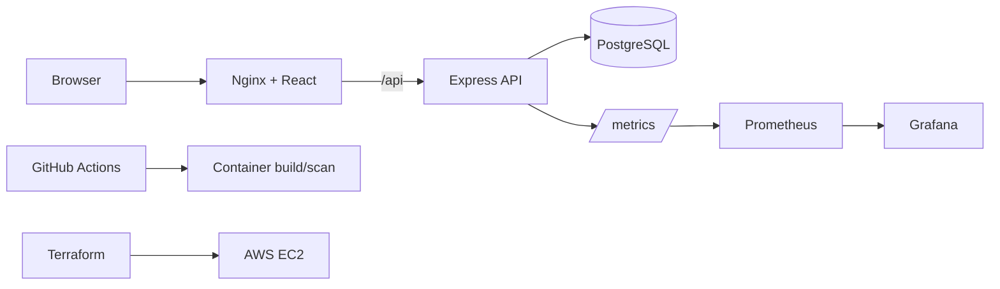

# NovaBank — Banking Simulation

A demo-only fintech platform for a DevOps portfolio. Fictional funds only; this is not a real bank or payment service.

## Stack
React + TypeScript + Vite · Node.js + Express + TypeScript · PostgreSQL + Prisma · Docker Compose · GitHub Actions · Terraform/AWS EC2 · Prometheus + Grafana.

## Quick start
1. Copy `.env.example` to `.env` and change the local passwords.
2. Start services: `docker compose up --build -d`
3. Apply schema and seed demo accounts:
   `docker compose exec api npm run db:deploy`
   `docker compose exec api npm run db:seed`
4. UI: http://localhost:8080 · API health: http://localhost:3000/health · Prometheus: http://localhost:9090 · Grafana: http://localhost:3001

## API
- `GET /health`, `GET /ready`, `GET /metrics`
- `GET /api/v1/accounts`
- `GET /api/v1/accounts/:id/transactions`
- `POST /api/v1/transfers` requires `Idempotency-Key` header.

Example:
```bash
curl -X POST http://localhost:3000/api/v1/transfers \
  -H 'Content-Type: application/json' -H 'Idempotency-Key: demo-transfer-001' \
  -d '{"fromAccountId":"demo-checking","toAccountId":"demo-savings","amount":"25.00","currency":"USD","description":"Demo transfer"}'
```

## Architecture


## Engineering controls
- Integer cents for money arithmetic; decimal strings at API boundary.
- PostgreSQL transaction with sorted row locks, balance checks, account status and currency validation.
- Double-entry ledger entries written atomically with transfer records.
- Unique idempotency key and request fingerprint prevent duplicate transfers.
- Helmet, rate limiting, strict input validation, limited request body size, non-sensitive error responses.
- Tests for money parsing and ledger invariants.
- PostgreSQL is not published on a host port. Do not expose Prometheus/Grafana publicly in AWS.

## Run tests
`npm install && npm run lint && npm test && npm run build` (the lockfile is generated on first install; commit it for repeatable CI builds).

## AWS starter
Terraform in `infra/terraform` provisions a demo EC2 instance and restricted SSH security group. Copy `terraform.tfvars.example` to `terraform.tfvars`, use the AWS key-pair **name** (not `.pem` filename), and set your IP as `/32`. Review costs and rules before `terraform apply`.

Configure GitHub secrets `EC2_HOST`, `EC2_USER`, `EC2_SSH_KEY`, and variables `DEPLOY_PATH` for the manual deploy workflow. The Terraform user-data installs Docker and the Compose plugin; allow the instance initialization to finish before deploying. The target EC2 host must have a server-side `.env` file created before the workflow starts. The starter cloud setup is not a production banking architecture.

## Limitations
This is a learning project, not a regulated financial service. It has no real-money integration and no full customer authentication/authorization. Before any real deployment, add verified identity, strong auth, authorization, TLS, managed secrets, private networking, database backups, audit controls, threat modeling, and independent security review.
